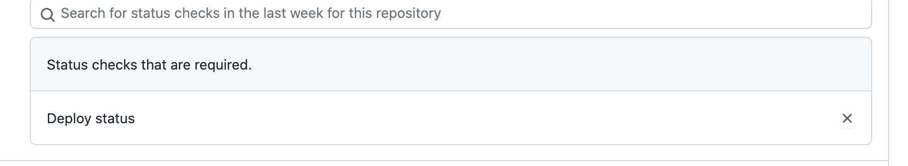
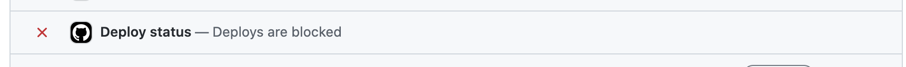

# Deploy status action

GitHub Action that blocks all deploys based upon an issue being raised with the "block deploys" label. If someone would
want to override the deploy, they would simply title their PR with "emergency deploy" label. This will unblock that
specific PR.

## Installation

1. Create a GitHub App with these repository permissions and install it on your repository:
   - Commit statuses: read and write
   - Issues: read-only
   - Pull requests: read-only

   Store the app's client ID and a private key as the secrets `CLIENT_ID` and `PRIVATE_KEY`.

2. Create a file called .github/workflows/deploy-status.yml in your repository with the following YAML:

   ```yaml
   name: Deploy Status

   on:
     pull_request_target:
       branches:
         - master
       types: [opened, labeled, synchronize]
     issues:
       types: [labeled, closed]

   # The action authenticates as the GitHub App, so the workflow's own token
   # needs no permissions
   permissions: {}

   jobs:
     build:
       runs-on: ubuntu-latest
       steps:
         - name: Deploy Status Action
           uses: simplybusiness/deploy-status-action@v3
           env:
             CLIENT_ID: ${{ secrets.CLIENT_ID }}
             PRIVATE_KEY: ${{ secrets.PRIVATE_KEY }}
             AIRBRAKE_KEY: ${{ secrets.GH_AIRBRAKE_KEY }}
   ```

   The action is bundled, so there is no need to check it out or to set up Ruby first.

   All three variables must be given. `AIRBRAKE_KEY` may be empty; with a key, errors are also reported to Airbrake. An
   error never fails the step, so look for `Unexpected error occurred` in the log when a status is missing.

   **NOTE:** We recommend you use `pull_request_target` event as mentioned in example as it will work when you create
   PRs from a forked repository with provided permission. You can also use `pull_request` event but that will work only
   for the PR in same repository. In a public repository, GitHub blocks `pull_request_target` from 2 December 2026
   unless an
   [Actions policy](https://docs.github.com/en/actions/reference/security/securely-using-pull_request_target) allows
   it.

3. Create `block deploys` for blocking the deploy and `emergency deploy` labels which can be use for overriding the
   blocked deploys.

4. Add deploy status as required check in branch protection.

   

5. To block the deploy now open an issue with label `block deploys`. It will block all the deploys and show the status on
   PRs.

   

## Migrating from v2

v2 was written in Ruby, so a workflow had to check the action out and set up Ruby before it could run it. With v3:

1. Delete the `actions/checkout` step that checks out `simplybusiness/deploy-status-action`, and the `ruby/setup-ruby`
   step.
2. Change `simplybusiness/deploy-status-action@v2` to `simplybusiness/deploy-status-action@v3`.

Keep the triggers, the job name and the three `env` lines as they are.

The action does what it did before, with two additions. When it sets the status of every open PR, it leaves a short
gap between one PR and the next. And when GitHub says a rate limit has been reached, it waits for as long as GitHub
asks, up to two minutes, and then carries on, where v2 stopped.

v2 keeps working but gets no further updates.

## Blocking the deployment pipeline

To manually block the deployment pipeline, raise a new issue in GitHub (re-opening an issue won't block the deployment
pipeline) with a title and add the label "block deploys". This will trigger an action within Github that will block all
PRs from merging to master. You will see a notification in all PRs that says: `Deploy status: Deploys are blocked`
This will take around a minute to update the status of all PRs. If you need to deploy to staging to test first, block
the deployment pipeline, then wait until all other PRs have been deployed before you merge your PR in. If you don't do
this, your work will be bundled with other commits and things can get confusing!

## How to deploy a fix when the deployment pipeline is blocked

If you would need to deploy a fix while the deployment pipeline is blocked, you will need to add to your PR the "
emergency deploy" label. Once added, you will see in a minute or so, that the deployment pipeline is free for YOU only
and you will be able to merge. It is IMPORTANT to note that the "emergency deploy" label should only be added to a PR
that is fixing the issue that is causing is deployments to be blocked. It is never acceptable to add the "emergency
deploy" label to a PR that is not meant to address the underlying issue blocking the deployment pipeline.

## How to unblock the deployment pipeline

When you are ready to release the deployment pipeline, close the open issue in GitHub (do NOT remove the label). The
deployment pipeline will then be unblocked for all PRs in the repo. When the deployment pipeline is clear and you are
ready to merge, you will see this notification: `Deploy status - You are free to deploy`

## Development

```shell
nvm install
npm ci
npm test
```

The action that runs is the bundle in `dist/`. After changing anything in `src/`, run `npm run build` and commit the
result; a pull request whose `dist/` is out of date fails its checks.

`src/test-utils/fixtures/golden/` records what the Ruby action (v2) did in each of the scenarios in
`src/test-utils/scenarios.js`: the requests it made, what it printed, the step summary and the exit code. `npm test`
holds the source to those recordings, and `npm run test:parity` holds the bundle to them.

## Releasing

Merging to `master` releases the version in `package.json`. The release workflow runs the merged action against this
repository and, if that sets a status, tags `vX.Y.Z`, creates the release and moves the `v3` tag to it. Do not tag by
hand.

- A pull request that changes `dist/` or `action.yml` must bump the version. Comment `/dobby version patch` (or `minor`
  or `major`) on it, or run `npm version patch --no-git-tag-version`. A pull request that changes neither needs no
  bump and releases nothing; its "Version check" fails and can be ignored.
- On a Dependabot pull request that changes the bundle, wait for the "Rebuild dist" commit before commenting
  `/dobby version patch`.
- Checks do not start by themselves on a commit that a workflow pushed. Approve the waiting runs, or close and reopen
  the pull request.
- Whoever merges checks that the "Create GitHub Release" run passed. It releases nothing while an issue labelled
  `block deploys` is open in this repository. If a release run failed, run the one for the newest commit on `master`
  again, not an older one: the newest run releases everything before it.
- If a release was tagged but `v3` did not move, move it by hand:
  `git push --force origin <released commit>:refs/tags/v3`.

To take back a bad release:

1. Disable the release workflow: `gh workflow disable create-release-notes.yml`.
2. Move `v3` back: `git push --force origin <last good commit>:refs/tags/v3`. Workflows that use `@v3` pick this up on
   their next run.
3. Open a pull request with the fix and a higher version. Going back to an earlier version releases nothing, because
   its tag already exists.
4. Enable the workflow again with `gh workflow enable create-release-notes.yml`, then merge. Do not re-run the release
   run of the bad version.
